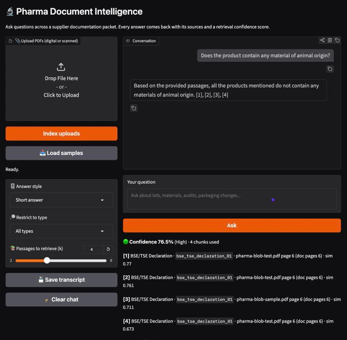
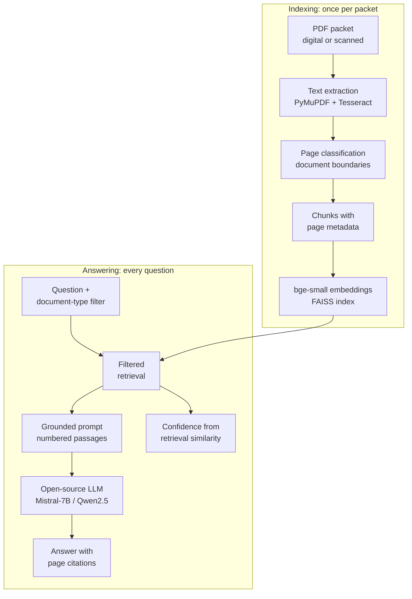

# AI-Powered Pharmaceutical Document Intelligence

[](https://github.com/Ophelie4/pfizer-document-intelligence/actions/workflows/tests.yml)


My work from the **Pfizer Advanced: AI-Powered Document Insights & Data Extraction Externship**, a 10-week program run by [Extern](https://www.extern.com) (June–September 2026).

Over nine projects I built a document intelligence system for pharmaceutical supplier documentation (SDFs). The finished system takes a single PDF "blob" that holds many documents, splits it into its separate documents, classifies every page, and answers questions through a Gradio chat interface. Every answer comes with page citations and a confidence score. The whole pipeline runs on open-source models. I was selected from my cohort to present it to the Pfizer team on 3 September 2026.



**Author:** Ophelie Bisamaza · [GitHub](https://github.com/Ophelie4) · [LinkedIn](https://www.linkedin.com/in/ophelie-bisamaza)

**Jump to:** [Run the app](#run-the-app) · [How it works](#how-it-works) · [Results](#highlights) · [All nine projects](#projects) · [Final presentation](project-09-final-integration/reports/final-presentation-reading-the-blob.md)

---

## Highlights

- **20/20 pages classified correctly** across two real supplier packets, recovering 8 separate documents from single-file PDFs.
- **Metadata-filtered retrieval** cut off-target passages from 1.50 per query to 0.00 with no loss of recall.
- **A controlled LLM evaluation** of Gemini vs Mistral-7B vs Phi-2 vs TinyLlama with identical retrieval. Mistral matched Gemini on accuracy (14/15) with no data leaving the machine.
- **An OCR engine comparison** (Tesseract vs EasyOCR vs PaddleOCR) on a scanned Certificate of Quality, including debugging PaddleOCR's oneDNN backend crash.
- **Confidence measured from retrieval**, not from the model's tone, because a fluent wrong answer with a citation is the most dangerous failure in a compliance workflow.

## How it works



1. **Read every page.** PyMuPDF pulls the text layer. A page with almost no text is a scan, so it is rasterised and read with Tesseract instead.
2. **Find the documents inside the blob.** Each page is classified from its title. A "(continued)" page joins the document before it, and two same-titled pages with different lot numbers become two documents.
3. **Index with metadata.** Pages are split into overlapping chunks that keep their document type, document ID, page and page range, then embedded into a FAISS index.
4. **Retrieve, then answer.** A question can be restricted to one document type. The model only sees the numbered passages, must cite them, and must say so when they don't contain the answer.
5. **Score confidence from the evidence.** The score blends the top similarity with how much of the retrieved set agrees with it, so a lone weak match reads Low however fluent the answer sounds.

## Run the app

**In Colab (no setup):** open the capstone notebook and run all cells. It prints a public link to the app.

[](https://colab.research.google.com/github/Ophelie4/pfizer-document-intelligence/blob/main/project-08-gradio-rag-chatbot/notebooks/Pfizer_Capstone_Full_RAG_UI.ipynb)

**On your own machine or Hugging Face Spaces:** the same system is packaged as a standalone app in [`app/`](app/).

```bash
cd app
pip install -r requirements.txt
python app.py      # http://127.0.0.1:7860
```

The pipeline has tests that run in seconds with stand-in models: `pytest app/tests`.

## Tech stack

**Extraction & OCR:** PyMuPDF, pdfplumber, PyPDF2, Tesseract, EasyOCR, PaddleOCR, OpenCV, Pillow
**Data:** pandas, regex, JSON, ftfy, unicodedata
**RAG:** LlamaIndex, LangChain text splitters, FAISS, BM25, cross-encoder re-ranking
**Embeddings:** all-MiniLM-L6-v2, e5-small-v2, bge-small-en-v1.5
**LLMs:** Gemini (API), Mistral-7B-Instruct (4-bit / GGUF), Phi-2, TinyLlama, Qwen2.5 via llama.cpp and Hugging Face Transformers
**Interface:** Gradio · **Environment:** Google Colab (T4 GPU) · **Testing:** pytest, GitHub Actions

## Projects

| # | Project | What I built |
|---|---|---|
| 1 | [How AI Reads Pharmaceutical Documents](project-01-how-ai-reads-pharma-documents/) | Foundations of ML, LLMs, NLP and OCR; analysis of a real pharma document packet |
| 2 | [Python for Document Processing](project-02-python-for-document-processing/) | Python practice, pandas cleaning, JSON flattening, a 9-step text-cleaning pipeline, image preprocessing (denoise, CLAHE, Otsu) |
| 3 | [Data Extraction from Documents](project-03-data-extraction-from-documents/) | PDF library comparison; date and field extraction with regex, anchor phrases and bounding boxes |
| 4 | [OCR Comparison & Layout-Aware Extraction](project-04-ocr-comparison-and-layout-extraction/) | Scanned-PDF extraction; Tesseract vs EasyOCR vs PaddleOCR |
| 5 | [Introduction to RAG](project-05-intro-to-rag/) | LlamaIndex chatbot, chunking strategies, hybrid vector + BM25 retrieval with re-ranking, a complete RAG pipeline |
| 6 | [Advanced RAG & Open-Source LLMs](project-06-advanced-rag-and-open-source-llms/) | Embedding comparison, retriever tuning with a custom LLM re-ranker, local LLMs, the Gemini vs open-source evaluation |
| 7 | [Blob Processing, Classification & Routing](project-07-blob-processing-classification-routing/) | Splitting multi-document PDFs, page classification, query routing with metadata filters |
| 8 | [Gradio Chatbot with RAG](project-08-gradio-rag-chatbot/) | Document Q&A chatbot and the full RAG UI capstone: OCR fallback, FAISS, citations, confidence |
| 9 | [Final Integration & Evaluation](project-09-final-integration/) | End-to-end system and the final presentation to the Pfizer team |

## Repository layout

```
├── app/                    standalone version of the capstone app, with tests
├── assets/                 screenshots used in the READMEs
├── project-01 … project-09 one folder per project
│   ├── README.md           project summary and every written answer I submitted
│   ├── notebooks/          the Google Colab notebooks, with their outputs
│   ├── reports/            write-ups and slide decks, converted to Markdown
│   └── data/               output files, where a task produced them
└── .github/workflows/      runs the pipeline tests on every push
```

## Running the notebooks

Each notebook was built in Google Colab. Open one on GitHub and use **Open in Colab**, or upload it to Colab. Notebooks that call Gemini read `GOOGLE_API_KEY` from Colab Secrets. The open-source model notebooks need a GPU runtime (T4).

---

*This was an educational externship run by Extern. The sample documents were provided by the program for training purposes. This repository contains my own work and does not include confidential Pfizer data.*
