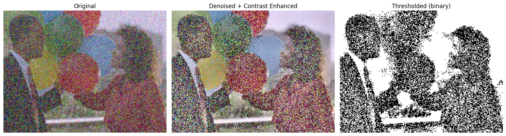

# Project 2: Python for AI-Powered Document Processing

**Weeks 2–3.** Python basics, data cleaning with pandas, working with JSON, text cleaning and standardization, and image preprocessing with OpenCV and PIL.

## Notebooks

| Notebook | Task |
|---|---|
| [`task1.ipynb`](notebooks/task1.ipynb) | Start a notebook on Google Colab |
| [`Task2.ipynb`](notebooks/Task2.ipynb) | Practice creating data structures |
| [`task3.ipynb`](notebooks/task3.ipynb) | Python basics practice (working notebook) |
| [`Ophelie-Control_Flow_Practice.ipynb`](notebooks/Ophelie-Control_Flow_Practice.ipynb) | Practice control-flow exercises |
| [`Ophelie-Functions_Practice.ipynb`](notebooks/Ophelie-Functions_Practice.ipynb) | Practice writing functions |
| [`Ophelie-Python_code_practice.ipynb`](notebooks/Ophelie-Python_code_practice.ipynb) | All 6 practice exercises |
| [`Ophelie-Python_Assignment.ipynb`](notebooks/Ophelie-Python_Assignment.ipynb) | Provide an input to generate an output |
| [`Ophelie-Loan_Data_Cleaning.ipynb`](notebooks/Ophelie-Loan_Data_Cleaning.ipynb) | Cleaning data using pandas |
| [`Ophelie_JSON_Task.ipynb`](notebooks/Ophelie_JSON_Task.ipynb) | Working with JSON data |
| [`Ophelie_Text_Cleaning.ipynb`](notebooks/Ophelie_Text_Cleaning.ipynb) | Text cleaning and standardization |
| [`Ophelie_Image_Preprocessing.ipynb`](notebooks/Ophelie_Image_Preprocessing.ipynb) | Enhancing a scanned document (denoising, CLAHE, Otsu) |

## Results

**Image preprocessing:** the original noisy image, then denoised + CLAHE contrast enhancement, then Otsu thresholding.



## Output files

- [`data/orders_flat.json`](data/orders_flat.json): the nested orders JSON flattened with `pd.json_normalize`
- [`data/cleaned_text.txt`](data/cleaned_text.txt): the text file after the 9-step cleaning pipeline
- The cleaned image is shown in the outputs of `Ophelie_Image_Preprocessing.ipynb`.

---

## Task answers

### Python basics (Colab setup, data structures, control flow, functions)
I created each notebook and finished all six practice exercises. I rated them "not difficult" to "not that difficult".

### Cleaning data using pandas
**Challenges:** 52 rows had -1 to -3 years. Options were: drop the rows (loses good data), set to 0 or median (loses information), or take absolute value (assumes a sign-entry error). I chose `abs()` because the magnitudes were small and consistent with a stray minus sign, but it's an assumption, not a certainty.

**Easiest part:** The duplicate check. It's two one-liners, `df.duplicated().sum()` and `drop_duplicates()`, with no judgment calls: a duplicate is either there or it isn't, and the fix is unambiguous. The missing-value check was nearly as easy.

### Work with JSON data
```python
import json

with open('sample.json', 'r') as f:
    data = json.load(f)

# All order IDs with their totals
for customer in data:
    for order in customer['orders']:
        print(f"Order ID: {order['order_id']}, Total: {order['total']}")

# Flatten into customer_id, order_id, product, quantity, total
import pandas as pd

df = pd.json_normalize(
    data,
    record_path=['orders', 'items'],
    meta=['customer_id', ['orders', 'order_id'], ['orders', 'total']]
)
df = df.rename(columns={'orders.order_id': 'order_id', 'orders.total': 'total'})
df = df[['customer_id', 'order_id', 'product', 'quantity', 'total']]
df
```

### Text cleaning and standardization
**Steps I took:**
1. Fixed encoding/mojibake issues with the `ftfy` library.
2. Removed HTML tags with a regex.
3. Expanded contractions (e.g. "won't" -> "will not") using the `contractions` library while apostrophes were still intact.
4. Normalized accented characters to plain ASCII and stripped emojis in the same step, using `unicodedata.normalize('NFKD', text).encode('ascii','ignore').decode('ascii')`.
5. Lowercased all text.
6. Removed random symbol runs like `@@` and `##` with a regex.
7. Standardized inconsistent price formats (`29.99 USD`, `29,99$`) into a single `$X.XX` format.
8. Stripped remaining punctuation, keeping `$` and `.` so prices stayed readable.
9. Collapsed repeated spaces and newlines into single spaces with `re.sub(r'\s+', ' ', text).strip()`.

**Most challenging step:** Getting the order of operations right for step 4 (accent normalization + emoji removal). My first attempt removed emojis with a blunt `text.encode('ascii','ignore')` pass done separately and too early, before running `unicodedata.normalize('NFKD', ...)`. Since that step drops any character it can't represent in ASCII, it deleted the accented letters entirely (e.g. "Thís" became "Ths") instead of converting them to their plain-letter equivalent. The fix was combining both into a single pass: `normalize('NFKD', text)` first decomposes each accented letter into a base letter plus a separate accent mark, and only then does `encode('ascii','ignore')` run, so it drops the accent mark (and any emoji, which has no ASCII form) while keeping the base letter intact. It was a good reminder that "clean junk characters" isn't one step, it's several, and the order they run in changes the result.

### Modify an image using OpenCV and PIL
**OpenCV vs PIL:** OpenCV is a computer vision library built for performance and complex image processing (filtering, edge detection, contour/feature detection, video), and it represents images as NumPy arrays in BGR channel order by default. PIL/Pillow is a simpler, more "Pythonic" imaging library aimed at basic loading, editing, and saving of images (resizing, cropping, format conversion) in RGB order. In short: PIL is easier for straightforward image manipulation and format handling, while OpenCV is better suited for the heavier numerical/analytical operations needed for computer vision and OCR preprocessing.

**Why grayscale before OCR:** Converting to grayscale collapses the 3 color channels into a single intensity channel, which reduces data size and computational cost and removes color noise/variation that has no bearing on character shape. Since OCR engines fundamentally rely on distinguishing dark text from a light background (contrast/edges), color information is unnecessary and can actually confuse thresholding steps. Grayscale also makes downstream steps like binarization (thresholding) and denoising simpler and more reliable, which directly improves recognition accuracy.

**Most useful transformation for documents:** Rotating (deskewing) is usually the most valuable for document processing. Scanned or photographed documents are very often slightly tilted from how they were fed into the scanner or photographed, and OCR accuracy drops sharply once text lines aren't roughly horizontal, since character segmentation and line detection assume aligned text. Cropping is a close second, useful for removing irrelevant borders/margins so the model focuses only on the content area, but a skewed page will hurt accuracy even if it's perfectly cropped, so correcting rotation first has the bigger impact.

**Fixing a blue-tinted background:** Convert the image to grayscale (e.g. `cv2.cvtColor(img, cv2.COLOR_BGR2GRAY)`) so the blue tint is discarded entirely and only intensity remains, then apply adaptive or Otsu thresholding (`cv2.adaptiveThreshold` or `cv2.threshold` with `THRESH_OTSU`) to binarize the image into clean black text on a white background. If some color-based separation is still needed before that, converting to HSV and working with the Value channel is another option, since it isolates brightness from the hue that's causing the tint. But for OCR specifically, grayscale plus adaptive thresholding is the standard, reliable fix.

### Enhance a scanned document using preprocessing
**Techniques applied:** Denoising with `cv2.fastNlMeansDenoisingColored()`, contrast enhancement with CLAHE (Contrast Limited Adaptive Histogram Equalization) applied to the L channel in LAB color space, and thresholding with `cv2.threshold()` using Otsu's method to produce a binary version.

**How each one helped:** Denoising (`fastNlMeansDenoisingColored`) removed the heavy speckle noise scattered across the whole image, smoothing color regions while still preserving edges better than a basic blur would. CLAHE contrast enhancement then made the flattened colors more distinguishable by locally boosting contrast on the lightness channel, without blowing out color balance the way a global equalization would. Otsu thresholding converted the result into a clean binary (black/white) image, which is the standard final step for OCR since it maximizes the separation between foreground and background pixels automatically, without needing a manually chosen cutoff.

**Challenges:** The provided sample was a busy color photo of people with balloons rather than an actual scanned text document, which made choosing a "cleaned" output less obvious than the task implied. Full Otsu binarization, applied directly, collapsed almost the entire photo into large black/white blobs and destroyed most visual content, since that technique assumes a document-like image with a clear foreground/background split rather than continuous photographic detail. So the challenge was picking which output to treat as the primary "cleaned" version: I used the denoised + contrast-enhanced (non-binarized) image as the main result since it best preserved readability for this photo, while still producing and documenting the binary-thresholded version to show the full technique set requested by the task.

---

## Project recap

**Highlight reel:** Flattening deeply nested JSON orders into a clean tabular format, catching and fixing a subtle text-encoding bug that was silently deleting accented characters instead of converting them, and building a real image preprocessing pipeline (denoising, CLAHE contrast enhancement, Otsu thresholding) with OpenCV.

**Skill I leveled up most:** Data cleaning and preprocessing judgment. Early on I was just following steps, but by the image task I was making and explaining a real tradeoff call (using the denoised/contrast version instead of a fully binarized one, since Otsu thresholding destroyed the photo's content) instead of blindly applying every technique.

**Hardest part:** Debugging why accented characters were disappearing entirely during text cleaning instead of being converted to their base letters. I pushed through by isolating each step of the pipeline and testing it separately, which showed the ASCII-encode step was dropping non-ASCII characters wholesale before the Unicode normalization step ran.

**What I'd change:** Clearer step-by-step instructions earlier in the module (step 2 of the JSON task was ambiguous about what output format was expected), so less time is spent guessing what's actually being asked before diving into the code.

**Project emoji:** 😅 challenging but worth it
