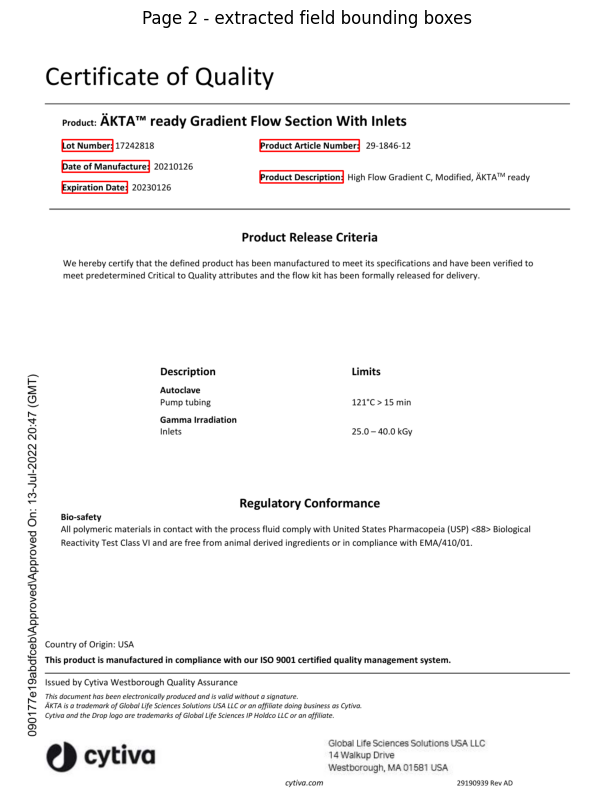

# Project 3: Data Extraction from Documents Using Python

**Weeks 3–4.** Extracting text from multi-page PDFs (PyPDF2, pdfplumber, PyMuPDF), then finding key fields like manufacturing and expiration dates with regex, anchor phrases and bounding boxes.

## Notebooks

| Notebook | Task |
|---|---|
| [`Ophelie_SDF_Extraction.ipynb`](notebooks/Ophelie_SDF_Extraction.ipynb) | Extract and structure data from SDFs with PyMuPDF (words and blocks) |
| [`Ophelie_SDF_Field_Extraction.ipynb`](notebooks/Ophelie_SDF_Field_Extraction.ipynb) | Extract key dates with regex, anchor phrases and bounding boxes, then draw the boxes back onto the pages |

## Results

**Extracted fields drawn back onto the page:** the bounding boxes found by the anchor-phrase + regex pipeline (Lot Number, Date of Manufacture, Expiration Date, Product Description) on page 2 of the SDF.

## Reports

- [SDF Extraction Results: PyMuPDF](reports/sdf-extraction-results-pymupdf.md)

---

## Task answers

### Quick reflection: choosing a PDF library
**Most intuitive library:** pdfplumber felt the most intuitive. Its API maps directly onto how you'd describe a page visually: `page.extract_text()` and `page.extract_table()` do what they say, and it's easy to inspect individual characters, words, and table cells without extra setup.

**Challenges:** PyPDF2 sometimes returned garbled or empty text on pages with unusual encoding or scanned content. And with all three libraries, plain text extraction on its own doesn't tell you which date belongs to which field. You lose the visual layout that makes that connection obvious to a human reader.

**Which library for a complex pharmaceutical SDF with multiple date formats?**
I'd pick PyMuPDF (fitz). Pharmaceutical SDFs mix tables, free text, and multiple date formats across sections, so raw text extraction alone isn't enough. You need to know where on the page a date actually sits to correctly link it to its label, like "Effective Date:" versus "Manufacturing Date:". PyMuPDF's word-level bounding boxes let you do exactly that: you can pull each word along with its (x, y) coordinates, then match a date string to the nearest label based on position rather than guessing from surrounding text alone. It's also significantly faster than pdfplumber on large multi-page documents, which matters when processing SDFs at scale. PyPDF2 is fine for simple, single-column text but has no concept of layout, and pdfplumber is great for tables but slower and more memory-intensive on big files. PyMuPDF strikes the best balance of speed, accuracy, and the positional metadata that structured, mixed-format documents like SDFs actually require, which is why it's the tool this module builds toward for the mandatory extraction task.

### Extract key dates from SDF documents
**Key date fields I identified:** Date of Manufacture (page 2: 2021-01-26, page 3: 2024-03-15); Expiration Date (page 2: 2023-01-26, page 3: 2026-03-15); the document/letter date on page 1 (3 June, 2022); and a "Received On" timestamp stamped on page 2 (13-Jul-2022 20:47 GMT).

**What surprised me most:** What surprised me was how easily the anchor-phrase + "same line" heuristic breaks on a two-column layout. Page 2 has Lot Number and Date of Manufacture stacked on the left while Product Article Number and Product Description sit at the same vertical height on the right. Because I grouped words into a field's value using `line_no` alone, the Date of Manufacture value accidentally swallowed the Product Description text from the other column, since PyMuPDF assigns them the same `line_no` even though they're in different columns. I solved it by validating the date portion with a regex so the pipeline still pulled the correct date even when the raw text grouping was messy, but the real fix is to also constrain candidate words by x-range instead of trusting `line_no` alone. The table extraction, by contrast, was surprisingly clean: `find_tables()` got all 6 rows of the results table on page 3 correct on the first try with no manual cleanup needed.

---

## Project recap

**Highlight reel:** Getting the anchor-phrase + bounding-box pipeline to correctly pull Date of Manufacture, Expiration Date, Lot Number, and Product Description straight off a real pharma document, then watching `find_tables()` nail all 6 rows of the results table on the first try, and finally seeing OpenCV draw the extracted bounding boxes right back onto the page images to visually confirm everything lined up.

**Skill I leveled up most:** Spatial/layout reasoning. Earlier tasks were mostly about getting text out correctly; this one forced me to think in coordinates, grouping words into a field's value based on bounding box overlap instead of just reading order, and noticing when that logic breaks across table columns.

**Hardest part:** Realizing my anchor-value grouping was pulling in text from a neighboring column, because PyMuPDF assigns the same `line_no` to words that are visually on the same horizontal line even if they are in different columns. I pushed through by printing the raw word list with its bbox and `line_no` for that page, spotting the overlap by eye, and adding a regex check on the date fields so the pipeline stayed correct even when the surrounding text grouping was messy.

**What I'd change:** I would add a short worked example showing the multi-column `line_no` pitfall before the mandatory task, since it is a non-obvious gotcha that cost me the most debugging time. A quick heads-up would save others from hitting the same wall.

**Project emoji:** 💡 so many lightbulb moments
