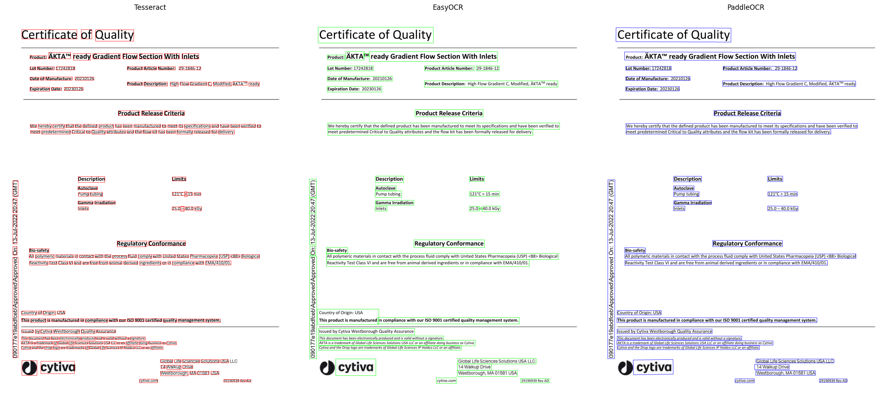
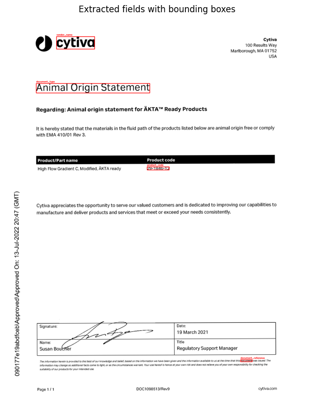

# Project 4: Advanced OCR Comparison and Layout-Aware Extraction

**Weeks 4–5.** Extracting text from scanned PDFs with Tesseract, then comparing Tesseract, EasyOCR and PaddleOCR on a real pharmaceutical Certificate of Quality.

## Notebooks

| Notebook | Task |
|---|---|
| [`Ophelie_Scanned_SDF_OCR.ipynb`](notebooks/Ophelie_Scanned_SDF_OCR.ipynb) | First version of the scanned-PDF analysis |
| [`Ophelie_Scanned_SDF_OCR_v2.ipynb`](notebooks/Ophelie_Scanned_SDF_OCR_v2.ipynb) | Analyze a scanned PDF with Tesseract (submitted version) |
| [`Ophelie_OCR_Engine_Comparison.ipynb`](notebooks/Ophelie_OCR_Engine_Comparison.ipynb) | Tesseract vs EasyOCR vs PaddleOCR |

## Results

**Tesseract vs EasyOCR vs PaddleOCR:** the bounding boxes each engine detected on the same scanned Certificate of Quality.

**Scanned-PDF extraction:** fields located on a preprocessed (denoised, thresholded, deskewed) scanned page.

## Reports

- [OCR Engine Comparison Report: Tesseract vs EasyOCR vs PaddleOCR](reports/ocr-engine-comparison-report.md)

---

## Task answers

### Analyze a scanned PDF
**Biggest challenge extracting clean, structured data:** The signature block was the hardest part. Tesseract dropped the "Name: Susan Boucher" line entirely. The handwritten signature overlaps the printed name text, so OCR just skipped it rather than misreading it, which is a harder failure mode to catch than a typo since nothing looks obviously wrong in the output. My anchor-based field lookup also missed the Date and Title values because their values sit on the line below the label instead of to the right of it, so my "look right of the anchor on the same line" logic simply never found them. I kept the raw OCR text and my structured JSON side by side in the output specifically so a human reviewer could catch gaps like this rather than trusting the structured fields blindly.

**Confident doing this on my own now?** Yes.

### Compare 3 OCR engines on a pharmaceutical PDF
I got all 3 engines running. The full write-up is in the [comparison report](reports/ocr-engine-comparison-report.md).

---

## Project recap

**Highlight reel:** Getting all three OCR engines (Tesseract, EasyOCR, PaddleOCR) running successfully on a real scanned pharma document, and especially finally cracking the PaddleOCR `NotImplementedError` bug after two rounds of debugging.

**Skill I leveled up most:** Debugging. I had to read stack traces from a compiled backend (PaddlePaddle's oneDNN/PIR executor) I'd never touched before, and noticed the growth when I isolated the fix to one specific flag (`enable_mkldnn=False`) instead of just guessing at fixes.

**Hardest part:** The PaddleOCR `NotImplementedError` crash. I pushed through by disabling preprocessing options one at a time until I isolated the real cause instead of guessing at a fix.

**What I'd change:** More guidance upfront on interpreting OCR confidence scores across engines before writing the comparison, so I could compare results more rigorously.

**Project emoji:** 🤯 my brain got a workout
